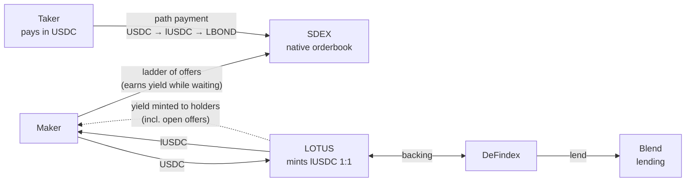

# Lotus

Yield-bearing liquidity for Stellar's native orderbook (SDEX).

Lotus wraps USDC into `lUSDC`, a classic Stellar asset whose backing is lent on Blend through a DeFindex vault. Because an SDEX offer never moves funds out of the account, a limit order quoted in lUSDC keeps earning while it waits in the book. Idle orders become productive capital.

Built at HackMeridian (Lisbon, 25-26 October 2026), Path Genesis, tracks Stellar Unlocked and Stellar Composed. Everything in this repository runs on Stellar testnet; nothing is deployed on mainnet.

## The problem

Orderbooks need depth. Depth comes from resting orders, and a resting order is capital that does nothing while it waits. The people who could provide depth, issuers with inventory and treasuries with cash, have the least reason to: a resting bid earns nothing, and an AMM position forces them into round trips they do not want (buy low, get sold back the asset higher, hold whatever the market leaves them). Call it the big-holder paradox: the holders who own the inventory and the cash are the ones who could fix depth, and they are the ones with the least incentive to park capital in a book.

The assets that suffer most are the ones that need a book: tokenized bonds and other real-world assets, which trade by appointment and in size.

Stellar has a specific version of this. The network already carries yield-bearing RWAs (Ondo's USDY launched on Stellar in September 2025; Etherfuse Stablebonds such as CETES trade on SDEX). The asset side of a bond pair earns while it sits. The quote side, the USDC, does not.

## The primitive

Lotus makes the quote side earn.

- `lUSDC` is a classic Stellar asset. The admin of its Stellar Asset Contract (SAC) is a Soroban contract, `lotus_vault`, which is the only minter and tracks supply.
- `deposit`: the user sends USDC to the contract; the contract deposits it into a DeFindex vault that lends on Blend, and mints lUSDC 1:1.
- `redeem`: the user sends lUSDC back; the contract burns it, withdraws from the vault and returns USDC. Payment is 1:1 while the position is fully backed, and pro-rata if the vault position has ever lost value.
- `distribute` (keeper-only): the keeper submits a list of holders and amounts. Every amount is capped on-chain by `surplus * balance / supply`, where `surplus` is the vault's value above outstanding lUSDC supply, and the total cannot exceed the surplus. The keeper can omit a holder; it cannot over-mint, and it cannot send one holder's yield to another. The admin can rotate the keeper with `set_keeper`.

Read-only entry points `supply`, `vault_value` and `surplus` expose the accounting, so anyone can check that outstanding lUSDC is backed. The exact interface is in [contracts/README.md](contracts/README.md).

A holder's lUSDC balance includes the amount committed to open offers, because on Stellar an offer is recorded as a selling liability on the account, not as a transfer. The maker whose bids sit in the book therefore earns exactly what a passive holder earns.

One-way behaviour comes for free. On an orderbook a filled offer never trades back. The first Lotus (a one-way directional-liquidity pool that won the Uniswap track at ETHGlobal New York 2026) had to build that property into a custom AMM. On Stellar the orderbook already is the one-way venue; Lotus only has to make the capital inside it productive.

## How it works



Two SDEX pairs are seeded on testnet:

| Pair | Role |
|---|---|
| `LBOND/lUSDC` | The RWA market. `LBOND` is a simulated tokenized bond, a classic asset issued with `AUTH_REQUIRED`, `AUTH_REVOCABLE` and `AUTH_CLAWBACK_ENABLED`. Only authorized trustlines can hold it. An unauthorized taker's trade fails at the protocol level; no contract logic is involved. |
| `USDC/lUSDC` | The peg book, quoted at 1:1. Anyone can deposit or redeem at par through the contract, so any deviation is an arbitrage against the vault and the book stays honest. |

A taker who holds only USDC buys LBOND with one path payment, USDC -> lUSDC -> LBOND, in a single transaction. The taker never needs to know lUSDC exists, so quoting in lUSDC does not fragment liquidity from the taker's point of view.

The flow for a maker:

1. Deposit USDC, receive lUSDC.
2. Post a ladder of bids on `LBOND/lUSDC` (and asks, if the maker holds LBOND). The lUSDC stays in the account as selling liabilities.
3. A keeper calls `distribute` periodically. The maker's lUSDC balance grows while the offers stay open.
4. When a bid fills the maker holds LBOND; when an ask fills the maker holds lUSDC that is already earning.
5. Redeem lUSDC for USDC at par whenever needed.

## Stellar features used

| Feature | Where it is used |
|---|---|
| SDEX offers and liabilities | Ladders of `manage_sell_offer` / `manage_buy_offer`. Offers reserve funds as selling liabilities instead of moving them, which is what lets an open order keep earning. |
| Path payments | `path_payment_strict_send` USDC -> lUSDC -> LBOND. One transaction, the taker pays in USDC. |
| Classic assets with a contract as admin | lUSDC is a classic asset. Its SAC admin is set to `lotus_vault` (`set_admin`), which mints on deposit and distribution and burns on redeem. |
| Asset authorization flags and clawback | The LBOND issuer sets `AUTH_REQUIRED`, `AUTH_REVOCABLE` and `AUTH_CLAWBACK_ENABLED`. Compliance is enforced by the protocol, not by the venue. |
| Soroban smart contract | `lotus_vault`: deposit, redeem, capped distribution, supply accounting, vault integration. |
| Horizon | Orderbook, trades, offers and account liabilities for the app and the demo. |

## Ecosystem tools used

- DeFindex: the vault the contract deposits into. It allocates the USDC to a Blend strategy.
- Blend: the lending market where the USDC earns.

On testnet the vault and pool are the testnet deployments of those protocols. See the deployment files for the exact addresses.

## Repository layout

```
contracts/      Soroban workspace: lotus_vault (the contract) and mock_vault
                (a DeFindex-like vault used in tests)
scripts/        Numbered testnet scripts (Node 20+, @stellar/stellar-sdk): demo accounts,
                RWA issuance and flags, receipt minting, SDEX seeding, path-payment demo,
                yield simulation, distribution keeper
web/            Next.js app: deposit / redeem, ladder view, yield display
deployments/    Testnet addresses: testnet.contract.json (contract, assets, roles) and
                testnet.classic.json (RWA asset, demo accounts, offers, tx hashes).
                Secret keys are gitignored.
docs/           Pitch deck, demo script, submission answers, FAQ for judges
```

## Quick start

Each part has its own README with the exact commands: [contracts/README.md](contracts/README.md), [scripts/README.md](scripts/README.md), [web/README.md](web/README.md). The outline:

```sh
# Contracts. Requires Rust 1.84+, the wasm32v1-none target and the stellar CLI.
stellar contract build
cargo test

# Scripts (Node 20+). The aliases below run the numbered scripts in order;
# arguments and details are in scripts/README.md.
cd scripts && npm install
npm run wait     # wait for deployments/testnet.contract.json
npm run setup    # create and fund the demo accounts
npm run issue    # issue the simulated RWA with authorization and clawback flags
npm run mint     # deposit the underlying, receive the receipt token
npm run seed     # post the RWA ladder and the peg book on SDEX
npm run take     # taker buys the RWA with USDC through a path payment
npm run yield    # testnet only: simulate accrued yield in the vault position
npm run keeper   # distribute the surplus to holders, capped on-chain

# Web app. See web/README.md.
cd web && npm install && npm run dev
```

## Testnet deployment

Addresses are recorded in `deployments/testnet.contract.json` (contract id, assets, admin, keeper, issuer) and `deployments/testnet.classic.json` (RWA asset, demo accounts, offers, transaction hashes). Those files are authoritative; the table below mirrors them.

| Item | Value |
|---|---|
| `lotus_vault` contract | [`CA5JHSNNGRX3QLLNRLOTDCXYGAYVC3ZRHXX6IWXQAD6YLILZ7TL2AHG6`](https://stellar.expert/explorer/testnet/contract/CA5JHSNNGRX3QLLNRLOTDCXYGAYVC3ZRHXX6IWXQAD6YLILZ7TL2AHG6) |
| Receipt asset `lUSDC` (classic) | issuer `GBBBCE5XIN3KPPNETITZF4ZEC6NG4MZZ3I2CYIQGGGY4GN4DJO73GDL6`, SAC `CDQ7HJZGK5RGIHAPWVCE7KVJIDOCQFPJI7CIYLRVNF5RKM62OJXL2HAV` (SAC admin = `lotus_vault`) |
| Underlying (Blend testnet USDC) | `USDC:GATALTGTWIOT6BUDBCZM3Q4OQ4BO2COLOAZ7IYSKPLC2PMSOPPGF5V56`, SAC `CAQCFVLOBK5GIULPNZRGATJJMIZL5BSP7X5YJVMGCPTUEPFM4AVSRCJU` |
| DeFindex vault (USDC) | `CBMVK2JK6NTOT2O4HNQAIQFJY232BHKGLIMXDVQVHIIZKDACXDFZDWHN` (Blend strategy `CALLOM5I7XLQPPOPQMYAHUWW4N7O3JKT42KQ4ASEEVBXDJQNJOALFSUY`) |
| Blend pool | `CCEBVDYM32YNYCVNRXQKDFFPISJJCV557CDZEIRBEE4NCV4KHPQ44HGF` (TestnetV2) |
| Keeper | `GD5UIZDBCBFKRESNOXR6SGLZKMU62TT6UWL2MHN546QQJNDUM3IYZZQM` |
| LBOND asset (code, issuer) | see `deployments/testnet.classic.json` (issuer account: `rwa_issuer` below) |
| `rwa_issuer` (demo) | `GCMNI332OEZL2AVBKJVDZ2IPREWMEYRENGFFVEGXS4JVXUWJEIAT5EQF` |
| `maker` (demo) | `GCJUR67CI37SF5QD3AYRVARR3SVFTINQHBSFGICSZEHXDZV2BZEQ46RV` |
| `taker` (demo) | `GAEC3F4ZKGYV4QPTBKN2TTRNQ5SEUAZRNE7AXFQPB4UWMWC4JYW36SI7` |
| `peg_lp` (demo) | `GANIQO23R5TLEYAGHCARVGXSLFI4ET27R4TCIOHC7MDQAWZB3LDRCMBH` |
| `blocked_taker` (demo) | see `deployments/testnet.classic.json` |

Demo account addresses were copied from `testnet.classic.json` on 25 October 2026 (funded by friendbot). If the files and this table disagree, the files win.

Testnet USDC comes from the Blend testnet faucet (the recipe is in `deployments/testnet.contract.json`, `notes`).

Smoke test on testnet (deposit, redeem, simulated yield, capped distribution): [`1307e6bf`](https://stellar.expert/explorer/testnet/tx/1307e6bf3456549c07752ecef45baea992c7e1ca185cc2eded98fd79b5a4624f), [`d1ec0985`](https://stellar.expert/explorer/testnet/tx/d1ec09856788d1c97f86c9624f130af0b20c52386cbb021ec73be7f44414f985), [`042c1ca7`](https://stellar.expert/explorer/testnet/tx/042c1ca78d62fba596bfa078fc09fe515e10e662b1cabca12cba5e31f4201131), [`d094e1b6`](https://stellar.expert/explorer/testnet/tx/d094e1b6c5dd289bae259cd5ff1f4b4d205c491876ae73d304e43ea9141a8353). An over-cap distribution was rejected with `ExceedsCap`.

**Testnet caveat.** At deployment time the DeFindex testnet USDC vault kept all deposits idle (strategy allocation 0), so testnet deposits do not reach Blend yet and earn nothing on their own. The demo shows yield by sending USDC to the contract, which raises `surplus()` exactly as accrued interest would. The contract path is the same once the vault manager allocates to the Blend strategy.

## Measured on testnet

- A withdraw from a DeFindex Blend strategy (measured by calling the strategy directly) used about 3.5M CPU instructions of the 400M per-transaction limit and touched 13 ledger entries of the 200 allowed.
- Those Blend-touching transactions cost around 100 XLM in fees on testnet. The cause was not isolated; ledger-entry rent is the likely driver. Mainnet cost has not been measured.
- The contract's own deposit and redeem, with the vault holding funds idle, cost 0.002 to 0.04 XLM.

## Limitations

- Redemption at par depends on Blend having liquidity to withdraw. If the pool is fully utilized, redemption waits; the peg book would then trade at a discount until liquidity returns.
- The `USDC/lUSDC` peg book needs a liquidity provider. In the demo that is us.
- Distribution is triggered off-chain by a keeper. The cap is enforced on-chain, so the keeper can only delay or omit, never steal. A holder who redeems between distributions forfeits the yield accrued since the last one to the remaining holders.
- Fees for Blend-touching operations are high on testnet (see above). Mainnet behaviour is unmeasured.
- Yield accrues on the quote leg (lUSDC) only. The asset leg earns whatever it earns on its own (for USDY or a Stablebond, that is the issuer's yield).
- Aquarius already runs concentrated-liquidity pools on Soroban. Lotus does not compete on ranges; it targets the orderbook and the capital that sits in it.
- On testnet the lUSDC issuer key is kept for recovery. On mainnet it would be locked after `set_admin`, so that the contract is the only possible minter.

## Roadmap

- Trustless distribution: per-holder claims from a snapshot or merkle root, or an exchange-rate token, so no keeper is needed.
- Aggregator integration: Soroswap and LumAgg already route through SDEX, so an `lUSDC` pair is routable today; the work is listing and pricing.
- More underlyings: EURC, then other quote assets with a lending market.
- Issuer tooling: ladder builders for primary distribution and buyback programs.
- Privacy: hidden maker identity through commitments, and later ZK proofs using the BN254 and Poseidon host functions shipped in Protocol 25 (X-Ray).
- Mainnet, once a production DeFindex USDC vault is available and the contract has been audited.

## Team

Alban Derouin, solo builder (product and integration). GitHub: skar8848.

The Lotus idea and brand come from the ETHGlobal New York 2026 team project. Everything in this repository, the contract, the classic-asset setup, the SDEX seeding, the keeper and the app, was built on Stellar during HackMeridian.
