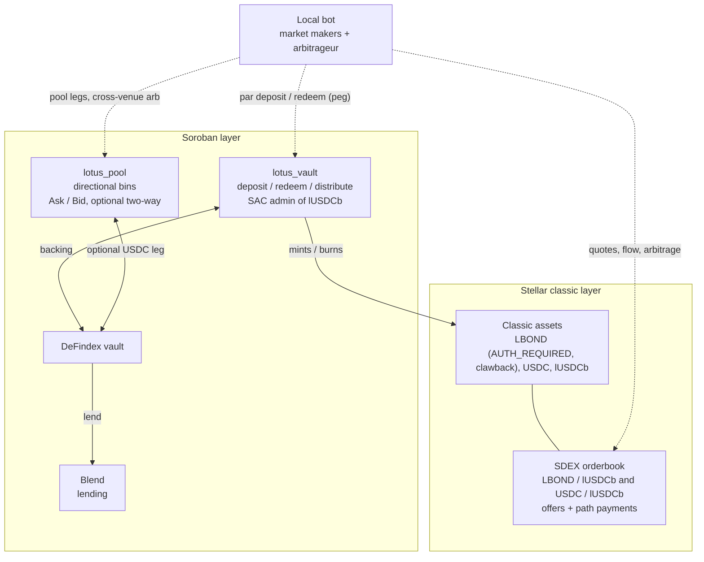

# Lotus

Directional liquidity and yield-bearing orders for Stellar.

**Live app (Stellar testnet): https://lotus-stellar.vercel.app**

Lotus is two products that work together:

1. **The Lotus pool** (`lotus_pool`, Soroban): a range pool on a grid of price bins where a liquidity provider chooses a direction. A directional position only sells its inventory and only receives proceeds; nothing trades back. The quote leg can optionally sit in a DeFindex vault that lends on Blend, so resting liquidity earns while it waits and is recalled just in time by the taker's own swap.
2. **The receipt token** (`lotus_vault`, Soroban, plus `lUSDCb` / `lUSDC`, classic assets): USDC deposited into a DeFindex vault comes back as a classic Stellar asset at 1:1. Classic assets can be quoted on the SDEX, and an SDEX offer never moves funds out of the account, so a limit order quoted in the receipt keeps earning Blend interest while it waits in the book.

Built at HackMeridian (Lisbon, 25-26 October 2026), Path Genesis, tracks Stellar Unlocked and Stellar Composed. **Everything in this repository runs on Stellar testnet; nothing is deployed on mainnet and nothing is audited.**

The first Lotus, a one-way directional-liquidity AMM, won the Uniswap track at ETHGlobal New York 2026. This is a new implementation on Stellar, written during HackMeridian; no EVM code is reused.

## The problem

Depth is idle capital. A resting order earns nothing, and an AMM position forces the holder into round trips they do not want (buy low, get sold back the asset higher, hold whatever the market leaves). The holders who own the inventory and the cash, issuers and treasuries, are the ones who could provide depth and have the least reason to.

Stellar has a specific version of this. The network already carries yield-bearing RWAs (Ondo USDY, Etherfuse Stablebonds). The asset side of a bond pair earns while it sits; the quote side, USDC, does not.

## One order, four places to wait

A liquidity provider creates one **range limit order** (sell LBOND across a price range, or USDC waiting to buy it) and chooses, at creation, where it waits:

| | Yield off | Earn yield (USDC leg in DeFindex on Blend) |
|---|---|---|
| **Lotus pool** | directional position on the idle pool · 1 signature | directional position on the vault-backed pool · 1 signature |
| **SDEX** | ladder of offers quoted in USDC · 1 signature | ladder quoted in the receipt `lUSDCb` · 1 signature (sell) or 2 (buy: deposit, then offers) |

Each bin of the range becomes one SDEX offer at the same price and size, so the order is the same wherever it waits. The choice is made once, at creation; there is no migration of a live position, so no partially filled position ever has to be moved.

The buy-side receipt order needs two transactions because a Soroban call must be the only operation of its transaction. The app has both signed up front and only submits the offers once the deposit has succeeded; if the deposit fails nothing moves, and if the offers fail the user simply holds the receipt, redeemable at par.

Curator rule: yield is not offered for a pool **bid** whose range starts within 10 bins (about 1 percent) of the price, because every trade would recall that USDC from the vault: little yield, more failure risk. Sell orders (yield is on proceeds that wait) and receipt orders on the SDEX (a receipt in an open offer keeps earning) are never blocked. The rule lives in the app; the contracts are unchanged.

## Architecture



The two venues for the same pair are linked off-chain by an arbitrageur and on-chain only through shared assets and the DeFindex vault. Prices on the pool and on the SDEX are free to differ; the bot closes the gap.

## Product 1: the Lotus pool

`contracts/lotus_pool/`. Full interface in [docs/pool-abi.md](docs/pool-abi.md), accounting and invariants in [contracts/lotus_pool/README.md](contracts/lotus_pool/README.md).

- **Bins.** Price at bin `n` is `1 * (1 + step)^n`, step 10 bps by default, bins -200 to 200, up to 64 bins per position. A swap walks the book through a bitmap of non-empty bins, at most 100 bins per call.
- **Directional by design.** `Side::Ask` deposits the base asset (LBOND) and receives USDC as it sells; `Side::Bid` deposits USDC and receives LBOND as it buys. Inventory only goes down and proceeds can never be bought back. The LP chooses this at `add_position`.
- **Optional two-way mode** (`Mode::TwoWay`, on a pool without a vault): DLMM-style bins that hold both assets, so a position can cross back when the price returns, for LPs who want Uniswap-like behaviour. Directional and two-way liquidity share the same book; at each price the swap takes directional liquidity first.
- **Optional yield vault.** A pool instance can hold its whole USDC leg (bid inventory, ask proceeds, fees) as DeFindex vault shares, so it earns Blend interest without any keeper. A buy swap deposits the taker's USDC; a sell swap withdraws exactly what the taker is owed, just in time. The yield strategy is a property of the pool instance: one instance per strategy (`deployments/testnet.pool.json`).
- **Fees.** 10 bps charged on top of the price leg and credited to the bin's LPs; the LP still receives its exact limit price.
- **Size.** 43.9 KB wasm (limit 128 KB). 58 unit tests plus a randomized solvency fuzz, an adversarial review with no solvency or overpay bug found, and known limitations written down (see Limitations).

Three live testnet instances, all LBOND/USDC:

| instance | yield | mode | contract |
|---|---|---|---|
| `lbond-usdc-idle` | none (USDC stays in the pool) | directional and two-way | [`CCE2ISQK…NHS4CA3`](https://stellar.expert/explorer/testnet/contract/CCE2ISQKVWZJAZL6FRW227WDVWXODWUZ75ZQXGPKJWXERRW64NHS4CA3) |
| `lbond-usdc-defindex` | Blend, through our DeFindex vault | directional | [`CDNG7T2K…ZFPNG`](https://stellar.expert/explorer/testnet/contract/CDNG7T2KSDQ7ZYXHSDAM63RLLVPCQ5V6T5GRTXOOX47EZEMU636ZFPNG) |
| `lbond-usdc-twoway` | none | directional and two-way | [`CC264FOW…SEI`](https://stellar.expert/explorer/testnet/contract/CC264FOWPI5R5FG4276ZIPGJ5OG5AP3IZ4RZNMC2KQNJDA7LQSFQ3SEI) |

## Product 2: the receipt token on the SDEX

`contracts/lotus_vault/`. Interface in [contracts/README.md](contracts/README.md).

- The receipt (`lUSDCb` on the active deployment, `lUSDC` on the older one) is a **classic Stellar asset**. The admin of its Stellar Asset Contract is the `lotus_vault` Soroban contract, which mints on deposit and distribution and burns on redeem, and tracks supply.
- `deposit`: USDC goes into a DeFindex vault that lends on Blend; the receipt is minted 1:1.
- `redeem`: the receipt is burned, the vault is withdrawn from, USDC is returned. 1:1 while fully backed, pro rata if the vault position ever lost value.
- `distribute` (keeper only): the keeper submits holders and amounts; every amount is capped on-chain by `surplus * balance / supply`, and the total cannot exceed the surplus. The keeper can omit a holder; it cannot over-mint or redirect yield. Balances locked in open SDEX offers count, because an offer is a selling liability, not a transfer.
- Two SDEX pairs: `LBOND/lUSDCb` (the RWA market) and `USDC/lUSDCb` (the peg book at 1:1, kept honest by par deposit and redeem). A taker holding only USDC buys LBOND with one path payment, USDC -> receipt -> LBOND, and never has to know the receipt exists.
- `LBOND` is a simulated tokenized bond issued with `AUTH_REQUIRED`, `AUTH_REVOCABLE` and clawback. An unauthorized taker's trade fails at the protocol level (`op_not_authorized`); the pool contract itself is authorized by the issuer through the LBOND SAC.

## The app

`web/`, Next.js 16, the look of the previous Lotus front (black, soft pink `#F3B1CE`, pro-mode range builder). Three pages:

- **Trade**: the front of the SDEX. Market selector, candles and depth, order book, recent trades; Swap (path payment), Limit, and Range (a ladder of up to 50 offers in one transaction, one-way sell, one-way buy or two-sided band); open offers with Cancel.
- **Pools**: the Lotus pool (instance picker, depth by bin, range builder for directional and two-way positions, claim and remove, pool swap with a venue comparison against the SDEX) and the vault tab (strategy cards, deposit and redeem, yield explainer).
- **Portfolio**: pool positions, Lotus receipts with the yield already paid by the keeper, open offers, then balances (available versus committed to offers).

Any Stellar Wallets Kit wallet works (Freighter, xBull, Albedo, Lobstr, Hana). A dev-only secret-key signer, gated by an environment variable, was used for headless testing. See [web/README.md](web/README.md).

## Where the volume comes from

The trades you see on the Lotus testnet markets come from three accounts run by the Lotus team (`mm_a`, `mm_b`, `arb`, listed in [deployments/testnet.bot.json](deployments/testnet.bot.json)): two market makers quoting and trading against each other, and an arbitrageur. They trade real on-chain transactions with assets the team issues (LBOND) or mints through `lotus_vault` (the receipt, minted against Blend testnet USDC from the public faucet). **It is market-maker volume, not user volume.** Nobody else uses these markets yet, it is a testnet, and we say so. See [scripts/bot/README.md](scripts/bot/README.md).

Measured runs of the bot (testnet, 25 October 2026):

- A depeg of the receipt to 0.985 was restored by the arbitrageur in 10 to 12 seconds on both vault deployments. The arbitrageur's profit in those scenarios is a transfer from the account that created the dislocation, not revenue.
- A cross-venue dislocation between the pool and the SDEX was closed in 26 seconds.
- The scripted demo run lasts about 167 seconds with 25 flow trades and ends with a keeper distribution that minted real interest to 6 holders.
- Two 10-minute runs: 0 failed transactions and 0 HTTP 429 inside those windows, about 0.52 XLM spent in total. Over the accounts' whole history, `mm_a` has 11 failed transactions out of about 1,300 (underfunded, offer not found); `mm_b` and `arb` have none.

## Why there is real yield on testnet (v2), and why there was none before

The Blend testnet pool is real and pays real supply interest. The DeFindex testnet USDC vault that existed (PaltaLabs, v1) never earned: DeFindex invests a deposit in proportion to the vault's existing allocation and skips an asset with nothing invested yet, and only the vault's rebalance manager can seed it. So deposits stayed idle. For v2 we created our own DeFindex vault through the testnet factory and seeded it into the Blend strategy with one `rebalance`; every later deposit is invested in full. Observed over two windows totalling about 34 minutes: 6.9 percent APR gross (the pool's `b_rate` growth). That rate follows Blend's testnet utilization (88.7 percent at the time; at 70 percent the rate model gives about 1.6 percent), so it is an observation, not a forecast. BLND emissions are not included.

## Testnet deployment

Addresses live in `deployments/`: `testnet.contract.json` (active vault), `testnet.strategies.json` (every strategy), `testnet.pool.json` (pool instances), `testnet.classic.json` (RWA, demo accounts, offers), `testnet.bot.json` (bot accounts). If this README and those files disagree, the files win.

| | v2 `usdc-defindex-blend` (active, live yield) | v1 `usdc-defindex-idle` (never lent: the instant buffer) |
|---|---|---|
| `lotus_vault` | [`CCCZ6XUD…2QKG`](https://stellar.expert/explorer/testnet/contract/CCCZ6XUDCWTOKZS6AYNECY3QPOFBICGMBBZXM63U4WZQD4EBFYFW2QKG) | [`CA5JHSNN…AHG6`](https://stellar.expert/explorer/testnet/contract/CA5JHSNNGRX3QLLNRLOTDCXYGAYVC3ZRHXX6IWXQAD6YLILZ7TL2AHG6) |
| Receipt asset (classic, SAC admin = the contract) | `lUSDCb`, issuer `GC7QBZD2LMPZZ3BT4ZLKPYUR23GJKT47BLYJKMXUY523M7HMUGT64TVO` | `lUSDC`, issuer `GBBBCE5XIN3KPPNETITZF4ZEC6NG4MZZ3I2CYIQGGGY4GN4DJO73GDL6` |
| DeFindex vault | [`CDCIDX5F…Q7EEC`](https://stellar.expert/explorer/testnet/contract/CDCIDX5FXOENXW4ODR2D7QMRKL4F2NTZYFVZEFF63GTNRVVDXLCQ7EEC) (ours, seeded into Blend, fee 0) | `CBMVK2JK…DWHN` (PaltaLabs, allocation 0: idle) |
| Yield | real Blend interest | none |

Shared: Blend testnet USDC `USDC:GATALTGTWIOT6BUDBCZM3Q4OQ4BO2COLOAZ7IYSKPLC2PMSOPPGF5V56`, Blend pool `CCEBVDYM32YNYCVNRXQKDFFPISJJCV557CDZEIRBEE4NCV4KHPQ44HGF`, LBOND issuer `GCMNI332OEZL2AVBKJVDZ2IPREWMEYRENGFFVEGXS4JVXUWJEIAT5EQF`. `deployments/switch-strategy.sh v1|v2|status` swaps the active vault.

Verification: v2 end to end with real interest (deposits of 100, 50 and 100 USDC fully invested, a `distribute` that minted real interest pro rata, a redeem of 50 `lUSDCb` paying exactly 50 USDC through the Blend withdrawal), v1 smoke test including an over-cap distribution rejected with `ExceedsCap` (rejected by the contract in simulation, so no failed transaction exists on-chain), pool smoke tests on every instance, a path payment on v2 that delivered 152.49 LBOND, and `blocked_taker` rejected with `op_not_authorized`. Transaction hashes are in the `deployments/*.json` files.

Measured costs: Soroban calls on testnet, including those that touch Blend, cost 0.0015 to 0.14 XLM. A withdraw from the DeFindex Blend strategy used about 3.5M CPU instructions of 400M and 13 of 200 ledger entries. Mainnet cost is unmeasured. (An earlier single measurement of about 100 XLM per Blend call did not reproduce and is retracted.)

## Stellar features used

| Feature | Where |
|---|---|
| SDEX offers and liabilities | Ladders of `manage_sell_offer`. Offers reserve funds as selling liabilities, which is what lets an open order keep earning. |
| Path payments | `path_payment_strict_send` USDC -> receipt -> LBOND, one transaction. |
| Classic asset with a contract as admin | The receipt's SAC admin is `lotus_vault`. |
| Asset authorization and clawback | LBOND `AUTH_REQUIRED`, `AUTH_REVOCABLE`, `AUTH_CLAWBACK_ENABLED`; the pool must be authorized through the LBOND SAC. |
| Soroban | `lotus_pool` (range pool), `lotus_vault` (receipt wrapper), a mock vault for tests. |
| Ecosystem | DeFindex vaults, Blend lending. |
| Horizon | Orderbook, trades, offers, liabilities for the app and the bot. |

## Repository layout

```
contracts/      Soroban workspace: lotus_pool, lotus_vault, mock_vault (DeFindex-like, for tests)
scripts/        Numbered testnet scripts (Node 20+, @stellar/stellar-sdk), lib/, and bot/
                (market makers, flow, arbitrageur, keeper step, scenarios)
web/            Next.js app: /trade, /pools, /portfolio
deployments/    Testnet addresses (public). Secret keys are gitignored (*.secrets.json)
docs/           Pool ABI, pitch deck, demo script, submission answers, FAQ for judges
```

## Quick start

Each part has its own README: [contracts/README.md](contracts/README.md), [contracts/lotus_pool/README.md](contracts/lotus_pool/README.md), [scripts/README.md](scripts/README.md), [scripts/bot/README.md](scripts/bot/README.md), [web/README.md](web/README.md).

```sh
# Contracts. Rust 1.84+, wasm32v1-none target, stellar CLI.
stellar contract build
cargo test --workspace

# Scripts (Node 20+). Aliases run the numbered scripts in order.
cd scripts && npm install
npm run setup    # create and fund the demo accounts
npm run issue    # issue LBOND with authorization and clawback flags
npm run mint     # deposit USDC, receive the receipt
npm run seed     # post the LBOND ladder and the peg book on the SDEX
npm run take     # taker buys LBOND with USDC (path payment), then the blocked taker fails
npm run keeper   # distribute the real Blend interest to receipt holders (capped on-chain)
npm run bot      # market makers, flow, arbitrageur, pool legs; see scripts/bot/README.md
npm run bot:demo # the 3-minute scripted run

# Web app
cd web && npm install && npm run dev   # http://localhost:3000
```

## Limitations

Stated up front, because testnet is not mainnet.

- **JIT yield capture in `distribute`.** Interest is distributed by minting to current balances, so someone who deposits just before a distribution and redeems right after captures a pro-rata share they did not earn, and a holder who redeems earlier forfeits accrued yield to the others. Known weakness of the simple design; the fix is an exchange-rate token (share-price accounting). Until then the keeper should run often. The vault-backed **pool** does not have this problem: it accounts yield in vault shares.
- **Trust in the LBOND issuer.** LBOND is `AUTH_REVOCABLE` with clawback by design (it models a regulated RWA). The issuer can freeze or revoke a trustline, including the pool's. If the pool's LBOND trustline is revoked, USDC held for Bid positions could not be exchanged for LBOND (the swap fails; the Bid LP's USDC can be stuck until the issuer re-authorizes). A quote-only exit path for Bid LPs is on the roadmap.
- **Footprint race on the vault-backed pool.** The vault's idle balance can change by a stroop between simulation and inclusion, which fails the transaction with `ExceededLimit`. The app re-simulates and resends once. This was unit-tested but not exercised live.
- **Keeper and vault liveness.** Distribution needs a keeper; the cap is on-chain so it can only delay or omit. Redemption at par depends on Blend having liquidity; if the pool is fully utilized redemption waits and the peg book trades at a discount.
- **Junk bins.** Anyone can open tiny positions in many bins to lengthen swaps; mitigated by a minimum size per bin and `max_bins_per_swap`, not eliminated.
- **Sell-side denial of service on the pool (found in review, not fixed on-chain).** `remove_position` rounds the leaver's Bid inventory down, so a withdrawal can leave a few stroops in a bin. A Bid bin with less than one fillable unit is skipped by a sell but still counts toward `max_bins_per_swap` (100), and dust is only swept during a fill. An attacker who leaves such dust in the top 100 Bid bins (about 300 transactions, almost no capital) makes every sell fail with `NoLiquidity`, and can make it permanent by keeping a large position that turns new deposits into `BinDust`. Funds are not at risk: `remove_position` still works, buys and the SDEX are unaffected, and a fresh instance recovers. Fix (about 10 lines): when a removal leaves a Bid bin below the minimum per bin, fold the remainder into that bin's fees for the remaining LPs (same unit, no value transfer) and empty the bin. The contract has no upgrade path, so the live instances were not redeployed during the hackathon.
- **No pause, upgrade path or audit.** The pool admin can only change `max_bins_per_swap`. The receipt issuers are not locked on testnet (on mainnet the issuer would be locked after `set_admin`, so the contract is the only minter).
- **Reproducible builds.** Only the `idle` pool instance and the vault are reproducible from this repository: building HEAD with Rust 1.98.1 and stellar CLI 28.1.0 gives the deployed hashes (`caf426…` for the pool, `adfd23…` for the vault). The `defindex` and `twoway` instances run earlier builds whose exact source was not kept in git; they hold live positions (vault shares on `defindex`), so they were not redeployed. A LP cannot verify their code today. The toolchain is not pinned (`rust-toolchain.toml` is missing), and another Rust version gives a slightly different wasm.
- **Two-way bid side** was tested in unit tests, not live in the UI.
- **Receipt issuer trust (testnet).** The `lUSDCb` issuer key is not locked, so on testnet the team could print receipts classically and redeem them against the vault: a trust assumption on us until the issuer is locked after `set_admin` (mainnet requirement).
- **Vault edge cases.** `redeem` burns the full amount and pays what DeFindex returns (no revert if the vault pays a stroop less), and `deposit` mints 1:1 even if the vault were under-backed after a Blend loss (a new depositor would then recapitalise earlier holders). Neither has occurred on testnet; both are fixes for the next contract version (revert on shortfall, pro-rata mint when under-backed).
- **Pool details.** Sealed bin generations are not TTL-bumped by `claim`/`remove_position`, so a position in a bin left untouched for about 30 days needs a state restore before it can claim. The pool trusts DeFindex to deposit the full amount (true for a single-asset vault). The admin can lower `max_bins_per_swap`, which degrades swap depth but cannot move funds.
- **Faucet and the LBOND issuer key.** The faucet runs on Vercel with three server-side keys, one of them the LBOND issuer itself, which can freeze, revoke and claw back (including the pool's trustline). It authorizes the LBOND trustline of any address that asks, so on testnet the faucet stands in for the issuer's KYC desk: the point shown is that the protocol enforces authorization (`blocked_taker` fails with `op_not_authorized`), not that anyone checks identity. On mainnet the issuer would be multisig and authorization would go through the issuer's compliance service, with no mint or clawback power on any web server. Its limits (one claim per address, per-IP rate kept in memory per server instance) are soft.
- **Locked orders are a UI rule.** A product choice for the MVP, to avoid partial exits in the interface: pool positions and orders created with a yield strategy cannot be removed or cancelled from the app until filled ("Early redemption · soon"). The contracts never hold funds hostage: `remove_position` works at any time from the CLI, the SDK or the MCP server, and SDEX offers belong to the user's account, so any wallet can cancel them.
- **Keeper pays classic accounts only.** It lists receipt holders through Horizon (`/accounts?asset=`), so receipts held by a Soroban contract or a classic AMM pool receive nothing; their share goes to the other holders. A distribution to the issuer address would bypass the cap (its balance reads as `i64::MAX`), and the SAC rejects the mint; the next version refuses it explicitly.
- **Team-run everything.** No external user is proven yet. The trading volume is team-run market makers (see above), the keeper and the issuers are team keys, the DeFindex vault was created and seeded by the team (Lotus holds about 74 percent of its shares) and its manager, rebalance and emergency roles are one team key. LBOND is simulated: its fair value is a model in the bot (`scripts/bot/lib/nav.mjs`).
- Yield accrues on the USDC leg only. Mainnet cost and rates are unmeasured.

## Roadmap

- Exchange-rate receipt token: no keeper, no JIT capture.
- Early redemption with an exit fee, enforced in the contract. Not built in the UI during the hackathon on purpose: with no real curator allocation or withdrawable liquidity to protect on testnet, a UI-only fee would simulate a constraint that does not exist and could be skipped from the CLI.
- Quote-only exit for Bid LPs, pause and timelock, audit (OpenZeppelin's Stellar library as the base for access control).
- Aggregator listing: Soroswap and LumAgg already route through the SDEX and Aquarius, so the receipt pair is routable; the work is listing and pricing.
- More underlyings: EURC, then other quote assets with a lending market. A second yield strategy per pool (the pool design already takes one vault per instance).
- Privacy: hidden maker identity through commitments, later ZK with the Protocol 25 host functions.
- Mainnet once a production DeFindex USDC vault exists and the contracts are audited.

## Team

Alban Derouin, solo builder (product and integration). GitHub: skar8848.
